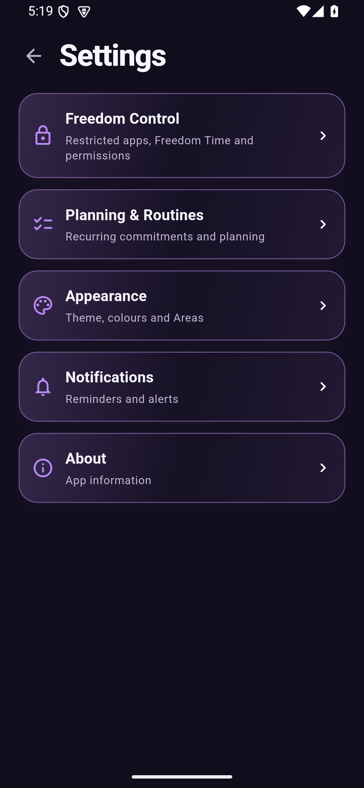
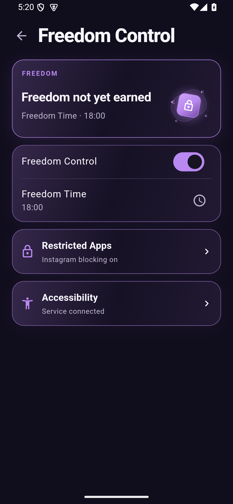
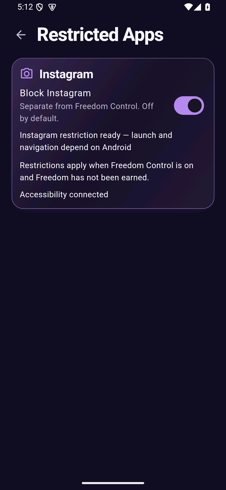
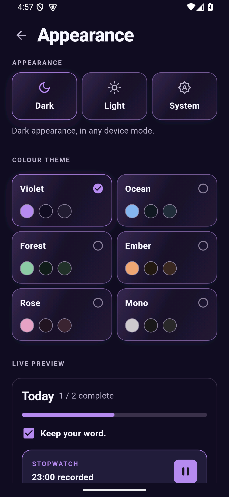
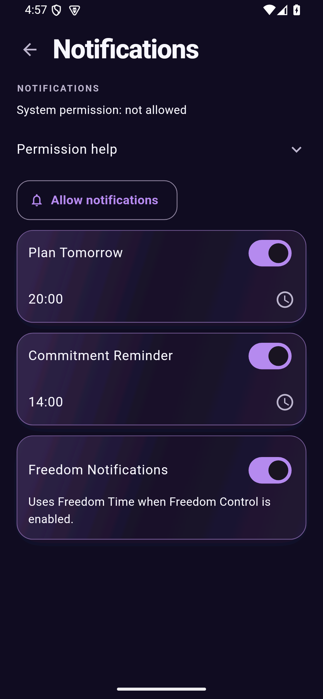
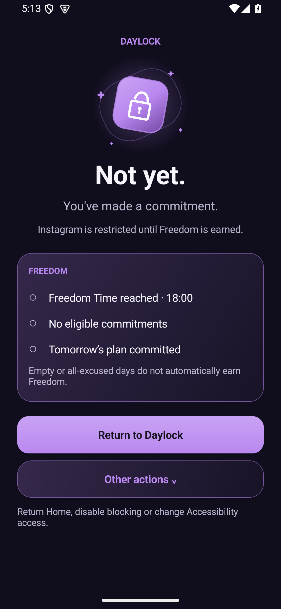

# Settings and blocking screen redesign

Settings now has five compact destinations, using the existing JourneySurface gradients, 20px corners, thin borders, theme typography and colours. Freedom Control reuses Today's DaylockIllustration. Today, Plan and Journey were not redesigned in this change.

## Where the existing controls moved

| Destination | Preserved controls |
| --- | --- |
| Freedom Control | Independent Freedom enable switch, time picker and live status from the existing FreedomService |
| Freedom Control > Restricted Apps | Instagram only; existing blocking preference, consent and save-error handling |
| Freedom Control > Accessibility | Service and native Freedom status, refresh and Android Accessibility settings; all previous technical diagnostics and setup instructions in an expansion |
| Planning & Routines | Manage Routines, count and unchanged editors |
| Appearance | Dark/Light/System, all six palettes and swatches, live preview, Manage Areas and count |
| Notifications | System permission/action, Plan Tomorrow and time, Commitment Reminder and time, Freedom Notifications; permission explanation in expandable help |
| About | Short Daylock description |

No existing setting was removed. The appearance preview now illustrates optional stopwatch time instead of an obsolete duration target. Selection changes continue through the original callbacks and storage. Pushed pages observe updated preferences, so controls and theme stay current without navigating back first. The fixed Back button remains accessible after scrolling.

## Files and components

- `lib/screens/settings_screen.dart`: destination routes, shared SettingsPage and SettingsNavigationCard, Freedom status hero.
- `lib/screens/appearance_settings_content.dart`: extracted appearance controls and preview, re-exported for existing callers.
- `lib/screens/instagram_detection_section.dart`: Instagram-only and diagnostic presentation modes; existing consent and bridge calls retained.
- `lib/screens/notification_settings_section.dart`: groups the existing controls in Journey surfaces.
- `lib/main.dart`: supplies existing FreedomService eligibility to Settings. No planner or persistence changes.
- `android/app/src/main/kotlin/com/example/daylock/InstagramLockActivity.kt`: presentation and secondary-action expansion only.
- `android/app/src/main/kotlin/com/example/daylock/DaylockLockArtwork.kt`: native Canvas counterpart of the existing Flutter lock artwork; no Flutter engine or raster asset needed.
- `test/settings_navigation_test.dart`: route/back navigation, independent controls, consent, diagnostic disclosure, callbacks and large-text regression coverage.
- Existing appearance, Areas, Freedom/routine, Instagram detection and Journey tests now follow the new navigation paths, retaining their behavioral assertions.
- `tool/android/LockScreenPreviewActivity.kt`: optional emulator preview fixture, outside Android source sets and absent from delivered APKs.

## Blocking behavior

DetectionService, package matching, blocking policy, Freedom calculations, native repository, launch sequencing, notification fallback and throttling are unchanged. No new permission, application ID or signing configuration was added. The Activity still uses the current attempt, native state, theme, lifecycle acknowledgements and clock updates. It distinguishes blocked, earned, paused and recovery states. Requirements use actual counts and times; an empty plan is shown honestly.

Return to Daylock retains its original intent flags. Home, Disable Instagram blocking and Accessibility Settings remain reachable in the clearly labelled Other actions panel, with a visible explanation even when collapsed. Disabling uses the original native persistence/error handling. There are no new automatic redirects.

## Actual Android captures

Captured from the running app on Android 15/API 35, AVD DaylockVisual35, 1080x2337 at 443 dpi (about 390x844 logical pixels). These are application screenshots, not design mockups. Different status values reflect actual settings changed during the test.

| Settings | Freedom | Restricted Apps |
| --- | --- | --- |
|  |  |  |

| Appearance | Notifications | Blocking |
| --- | --- | --- |
|  |  |  |

[Expanded blocker actions](screenshots/settings/blocking-actions.png) and [diagnostics](screenshots/settings/diagnostics.png).

Compared against the supplied Today/Plan/Journey screenshots and their actual components: matching background, typography, tinted surfaces, border treatment and lock motif. Visual inspection caught and corrected touching Freedom navigation cards and an overly dim native illustration. Large-text testing also caught and fixed an unwrapped Instagram heading. The native Canvas lock is a close counterpart, not a pixel-identical Flutter icon: orbit, small stars and shadow rendering differ slightly. Long subtitles and page titles wrap on narrow screens instead of being clipped. Appearance and expanded diagnostics intentionally scroll.

## Validation

- `flutter analyze`: no issues.
- `flutter test`: **673 passed**. Covers existing planner, stopwatch, Freedom, notification scheduling, theme persistence, routines, Areas, Today, Plan and Journey regressions. Updated route tests pass again after the final spacing change.
- New navigation tests: all five home destinations plus Restricted Apps and Diagnostics; back navigation after scrolling; consent before enabling Instagram or opening Accessibility settings; Freedom and Instagram switches remain independent; notification preference changes with OS permission denied. 390px at normal text and 320px at 200% text.
- Existing appearance tests retain all-palette, light/dark/system, storage/restart, failure/retry and running-stopwatch checks. Existing Freedom time persistence and Area/routine editing tests pass.
- Kotlin unit suite: **104 passed**, rerun after final native artwork change. Includes existing policy, repository, launch-flow and fallback coverage.
- Android debug and release builds completed. Test APK is version 0.1.0-alpha.13 / code 13, using the existing application ID and signing identity. The release APK installed over the emulator app successfully; Settings navigation worked after the update. SHA-256: `cf766a28f423f4ace58ba9f12688d36be5cdc8e568f20c7ac76bc04402ac8e52`.
- Emulator: navigated the Settings pages; captured all six requested screens; native logs confirmed `resumed_focused_drawn_unlocked` for the blocker. Return to Daylock, Home and Accessibility actions reached the expected destinations. Disable blocking returned Home and the native persisted flag read back false.

The native visual fixture launches the real Activity using the real saved state and existing policy, without fabricating eligibility. It does **not** demonstrate an Instagram-triggered background launch. UI Automator inspection can temporarily disconnect accessibility services, so the final blocked-state captures were taken after reconnecting the service, without UI Automator inspection. The preview Activity and temporary debug manifest entry were removed before delivery builds. See [fixture instructions](../tool/android/README.md).

## Physical-device checklist before publishing

- Install the update over the existing app; check commitments, recorded time, Areas, routines, history, themes and Freedom time remain intact.
- Open each Settings destination and return; scroll Appearance/diagnostics and check Back. Try larger system text and light/dark/system appearance.
- Change Freedom time, notification times and theme, restart, and verify saved values. Keep Freedom Control and Instagram blocking independent.
- Confirm Instagram enable consent, disable from Settings and the blocker, and revoke Accessibility access through Android settings.
- Open Instagram from launcher and Recents with Daylock foreground/background, process stopped, repeated rapid launches, and after service restart and screen lock/unlock. Check no navigation loop and all escape actions remain usable.
- Confirm requirements update after completing commitments, committing tomorrow and crossing Freedom Time; no fabricated counts or automatic stopwatch completion.
- Check denied notification permission and disabled channels; fallback notices should retain their existing throttling and leave Plan/Commitment/Freedom alerts unaffected.

Physical-device background launch reliability, OEM behavior and uninstall/revocation flows are not newly certified by emulator visual checks. Android still decides whether a background Activity may appear; the existing Home/notification fallback remains in place. Keep this APK in a draft release until phone testing is complete.
